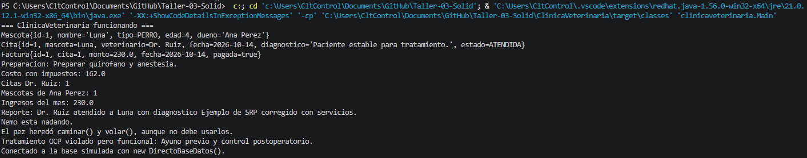

# ClinicaVeterinaria

Proyecto Java Maven para practicar refactoring con principios SOLID en un taller colaborativo.

El sistema funciona desde el inicio, pero contiene violaciones intencionales de SRP, OCP, LSP, ISP y DIP. La idea es que cada integrante refactorice una zona del código sin romper la ejecución.

## Setup en 5 minutos


Compilar con Maven. Salida esperada:

```text
=== ClinicaVeterinaria funcionando ===
```

## Estructura del proyecto

```text
src/main/java/clinicaveterinaria/
├── Main.java
├── interfaces/
│   ├── IAnimal.java
│   ├── IBaseDatos.java
│   ├── IServicioClinica.java
│   ├── ITratamiento.java
│   └── IVeterinarioService.java
├── model/
│   ├── Mascota.java
│   ├── Veterinario.java
│   ├── Cita.java
│   ├── Tratamiento.java
│   ├── Factura.java
│   └── clases auxiliares para animales y enums
├── repository/
│   ├── BaseDatos.java
│   └── DirectoBaseDatos.java
└── service/
    ├── ReservaService.java
    ├── DiagnosticoService.java
    ├── FacturacionService.java
    ├── ReporteService.java
    └── servicios CRUD y clases con violaciones intencionales
```

## Trabajo del taller

- Integrante 1: refactorizar SRP.
- Integrante 2: refactorizar OCP.
- Integrante 3: refactorizar LSP.
- Integrante 4: refactorizar ISP y DIP.

Lee `guia.md` para instrucciones, checklists y preguntas de discusión.

## Integrante 1.

- Principio: SRP.
- Violacion encontrada: Veterianario tenia datos y ademas reservaba citas, diagnosticaba, facturaba y generaba reportes, es decir, 5 razones para cambiar.
- Cambios hechos: Quitamos *reservarCita*, *diagnosticar*, *generarFactura* y *crearReporte* de *Veterinario*. La logica quedo en *ReservaService*, *DiagnosticoService*, *FacturacionService* y *ReporteService* con un metodo nuevo *generarReporteCita*. Se ha actualizado `Main.java` para usar los servicios.
- Checklist de la guia: compila, *Veterinario* ya no reserva ni diagnostica ni factura ni reporta, el `Main` Sigue funcionando y los nombres son claros.
- Respuestas a las preguntas de discusion:
    a - Antes tenia 5 razones para cambiar.
    b - Se gana codigo mas facil de cambiar, probar y entender, porque cada clase hace una sola cosa.
    c - Si cambia el formato del reporte solo cambia *ReporteService*.

Evidencia integrante 1: 

